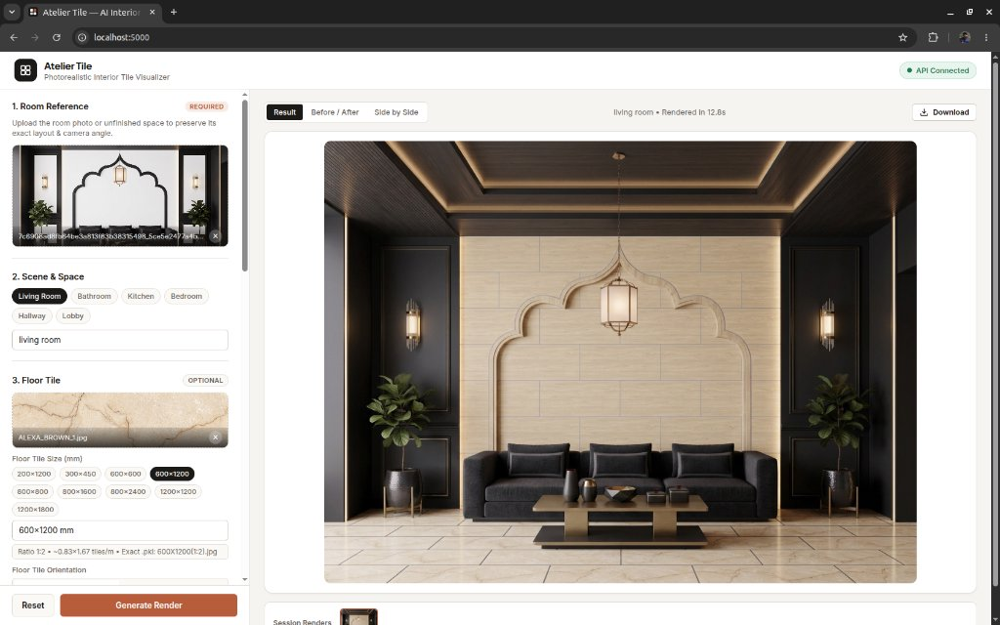

# Atelier Tile — AI Interior Tile Visualizer



A Flask + Google Vertex AI (Gemini Image Generation) web application for photorealistic interior tile visualization. Upload a room reference photo along with floor and wall tile swatches (Left, Center, and Right walls), customize tile sizes, surface finishes, and tile-matched grout colors, and compare the generated render against the original room.

## Features

- **Exact Layout & Camera Preservation**: Anchors the generated scene to the uploaded `main_image` room geometry, perspective, and proportions.
- **Floor Tile Visualization**: Optional floor tile swatch with configurable size (e.g., `600x1200 mm`), finish (`matt`, `glossy`, `high glossy`), and grout color.
- **3-Wall Tile Assignment**: Independent upload slots for **Left Wall** (`wall_tile_image_1`), **Center Wall** (`wall_tile_image_3`), and **Right Wall** (`wall_tile_image_2`). Any wall without a tile stays plain and smooth.
- **Smart Tile-Matched Grout Colors**: Client-side dominant color extraction analyzes uploaded floor and wall tile swatches to suggest harmonious or contrasting grout colors, alongside an **Auto** mode and a **Custom** color picker.
- **Interactive Studio UI**:
  - Live `/health` API status indicator
  - **Result**, **Before / After** split slider, and **Side by Side** comparison views
  - Session render history strip and one-click PNG download

## Project Structure

```text
AiPhotoGenerated/
├── app.py                 # Flask server, prompt builder, and Vertex AI Gemini integration
├── requirements.txt       # Python dependencies
├── .env                   # Environment variables (GOOGLE_CLOUD_API_KEY, MODEL_NAME)
├── templates/
│   └── index.html         # Atelier Tile web UI
├── static/
│   ├── style.css          # Studio UI styles
│   └── app.js             # Dropzones, tile color extraction, grout picker, slider & API client
├── uploads/               # Temporary upload storage (auto-cleaned after request)
└── generated_images/      # Saved output renders
```

## Setup & Run

1. **Configure `.env`**:

   ```env
   GOOGLE_CLOUD_API_KEY=your_vertex_ai_api_key
   MODEL_NAME=gemini-3.1-flash-image
   ```

2. **Install dependencies** (if not using the existing `venv`):

   ```bash
   python3 -m venv venv
   ./venv/bin/pip install -r requirements.txt
   ```

3. **Start the server**:
   ```bash
   ./venv/bin/python app.py
   ```
   Open `http://localhost:5000` in your browser.

## API Endpoints

- `GET /` — Serves the Atelier Tile web UI.
- `GET /health` — Returns `{ "status": "healthy", "service": "Interior Design Generator API Working" }`.
- `GET /api/tile-models` — Lists all tile size & aspect-ratio models loaded from `Models/tile_size_model.pkl`.
- `GET /api/analyze-tile-size?size=600x1200+mm` — Analyzes a `mm` tile size against `Models/tile_size_model.pkl` and returns aspect ratio, 1-meter tile counts, and closest reference model.
- `POST /api/match-my-room` (`multipart/form-data` with `main_image`) — Analyzes the uploaded room photo and returns 3 AI-recommended floor/wall tile & grout palettes.
- `POST /generate-prompt` (`multipart/form-data`):
  - `main_image` (file, **required**): Room reference photo (`png`, `jpg`, `jpeg`, `webp`, `heic`, `heif`; HEIC/HEIF auto-converts to 98% JPG).
  - `floor_tile_image` (file, optional): Floor tile swatch.
  - `wall_tile_image_1` (file, optional): Left wall tile swatch.
  - `wall_tile_image_3` (file, optional): Center/back wall tile swatch.
  - `wall_tile_image_2` (file, optional): Right wall tile swatch.
  - `scene` (string, optional, default: `"living room"`): Interior space type.
  - `floor_size_lable` / `wall_size_lable` (string, optional, default: `"600x1200 mm"`): Tile dimensions.
  - `floor_finish` / `wall_finish` (string, optional): `"matt"`, `"glossy"`, or `"high glossy"`.
  - `floor_orientation` / `wall_orientation` (string, optional, default `"horizontal"`): `"horizontal"` or `"vertical"`.
  - `floor_pattern` / `wall_pattern` (string, optional, default `"grid"`): `"grid"`, `"brick"`, `"herringbone"`, `"diagonal"`, or `"bookmatch"`.
  - `floor_grout_width` / `wall_grout_width` (string, optional, default `"2 mm"`): `"1 mm"`, `"2 mm"`, `"3 mm"`, or `"5 mm"`.
  - `aspect_ratio` (string, optional, default `"4:3"`): `"4:3"`, `"16:9"`, `"1:1"`, or `"3:4"`.
  - `floor_grout_color` / `wall_grout_color` (string, optional): Explicit grout color name/hex, or omitted for auto-contrast.
  - `sync_grout` (string/boolean, optional, default `"false"`): When `"true"`, unifies floor & wall grout color and aligns floor grout lines directly with wall grout joints.
